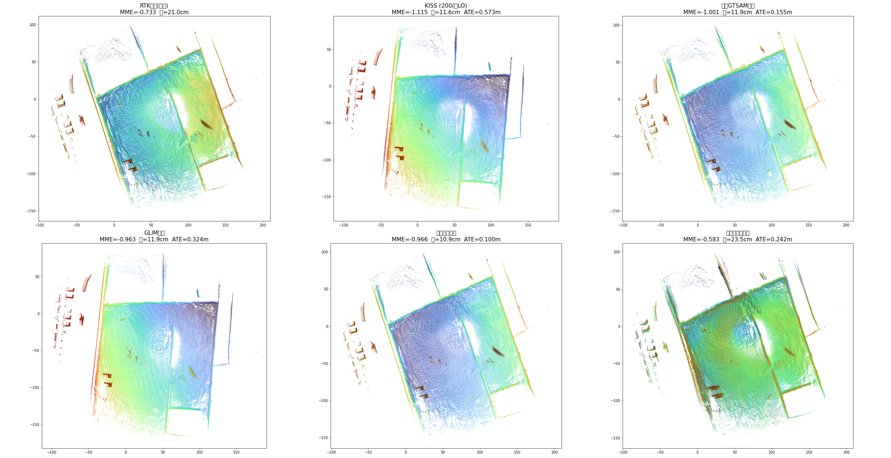
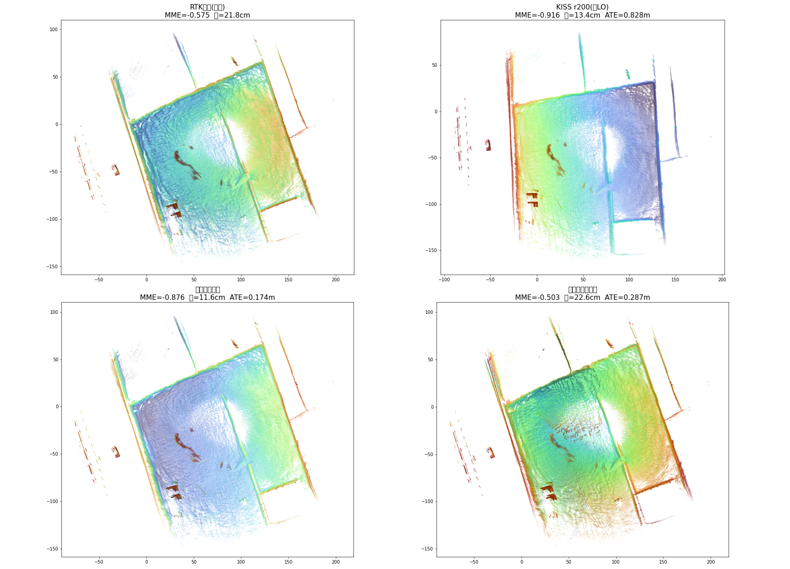

# 紧耦合原型实验报告：T_ins_lidar 外参能否进图联合估计

- 日期：2026-10-19 / 2026-10-20（汇报版）
- 作者：Hermes
- 数据：红沙泉 seg_164931_165748（段 A，497s，良性矿区道路）+ seg_153000_153351（段 B，231s，转弯密集段，§3.5 跨段一致性）
- 代码：`seg_164931_165748/kiss_icp_eval/round2_gtsam_fusion/tck_calib_v2.cpp`（单文件原型，GTSAM/iSAM2+批量LM 双后端）
- 上游设计稿：`docs/gnss/specs/2026-10-19-tight-coupling-extrinsic-calib-prototype.md`
- 关联：调研报告 `kiss_icp_eval/REPORT_final.md` §2.8（松耦合在线标定失败）；GLIM 侧 gauge 调查 `2026-10-19-shared-gauge-and-fixed-bootstrap-design.md`

## 0. TL;DR

| 问题 | 答案 | 证据强度 |
|---|---|---|
| 紧耦合（610 IMU 预积分 + GNSS 经外参 + 激光 between）值得做吗 | **值得，锁外参即目前最强前端**：ATE：段 A 0.100m / 段 B 0.174m（转弯密集段对 KISS 提升 4.8 倍）；比调研松耦合最优（0.155）好 35%，比 GLIM+CT+RTK（0.325）好 3.2 倍；地图锐度达纯 LO 的 87%（厚度全场最薄 10.9cm）+ ATE 最优，**双优** | 强（稳健性电池全过 + 跨段复现） |
| T_ins_lidar 平移能在线估计吗 | **不能（此数据/此架构）**：多模态，段 A 3 初值 3 解、段 B 2 初值 2 解，地图全部变差 | 强（电池 B + 代数同构证明 + 跨段复现） |
| T_ins_lidar 旋转能在线估计吗 | **不能可靠估计**：各初值收敛的旋转互相矛盾（yaw -1.4° ~ -3.2°），批量误差最小的解 yaw=-5.8° 物理不可信 | 中（电池 B 内部矛盾） |
| 为什么不行 | **610 杆臂混淆**：GNSS 锚用 INSPVA 融合位置（610 内部已按其配置的天线杆臂补偿），610 杆臂误差与 T_ins_lidar 平移误差在观测方程中精确同构（仅差常号），图无法区分 | 强（代数 + 数值验证） |

## 1. 系统与方法

原型在调研 `lrtk_odometry_calib.cpp` 骨架上重写（v2，全双线性因子）：

- **状态**：`X(k)=T_wl`（at128 雷达系位姿，ENU 世界）、`V(k)`（速度）、`B(k)`（IMU 零偏），10Hz 关键帧；共享变量 `T_li`（6DOF，标称 = tf_static 的 cgi610→at128 `[1.8868, -1.0062, -0.6516]` 旋转 I）
- **因子**：
  - IMU 预积分（610 原始 100Hz，自定义 `ImuExtrinsicFactor`：机体位姿 = `X·T_li⁻¹`，GTSAM 预积分 predict 后对 NavState 取 9 维误差）+ 零偏随机游走
  - GNSS 位置（自定义 `GnssExtrinsicFactor`：`pred = (X·T_li⁻¹).translation()` vs INSPVA 位置，σ=5cm）——T_li 平移的绝对观测通道（航向变化旋转杆臂）
  - 激光 between（KISS 相对约束 + 逐帧信息矩阵，不经外参）
- 求解：iSAM2 增量 / 批量 LM 双后端可切换
- 评估：evo（associate 0.06s + SE3 对齐不缩放 + ATE 平移），参考 `gt/gt_at128_flu.tum`

**v1 教训（记录在案）**：机体系状态 + between 共轭因子的初版里，T_il 平移只经 `R⁻¹(Rd-I)t` 的微分通道进图，10Hz 下 Rd≈I → 平移结构性不可观（E3 实证：估计值 = 初值+扰动，分毫不差）；gauge 三线性因子 `G·X·T_il` 在 iSAM2 下数值爆炸。v2 的全部双线性结构是为修这两个病。

## 2. 结果 A：锁外参紧耦合 = 当前最强前端（稳健）

**基线 ATE = 0.100m（med 0.045）**。稳健性电池（全部锁外参）：

| 变体 | ATE | 判读 |
|---|---|---|
| 基线 | 0.100 | ✓ |
| 外参 x +10cm | 0.139 | 水平敏感 |
| 外参 y +10cm | 0.136 | 水平敏感 |
| 外参 z +10cm | 0.100 | z 被对齐吸收（与调研 §2.8a 一致） |
| 外参水平 +20cm | 0.283 | ≈线性：水平 1cm ≈ +0.4cm ATE |
| 无 IMU（消融） | 0.128 | IMU 贡献真实但温和（0.100→0.128） |
| IMU 噪声 ×3 | 0.104 | 对噪声档位不敏感 |
| IMU 噪声 ÷3 | 0.102 | 同上 |

外参敏感性（水平 1cm→+0.4cm ATE）与调研松耦合（1cm→+0.5cm）同量级——外参精度仍是全局精度的硬约束，**标到 5cm 内的工程要求不变**。


## 2.5 建图精度：地图层指标（领导关注项）

把各方案的轨迹与 at128 原始帧缝合成地图，用**结构层 MME**（越低越锐）与**地面厚度**（1m² 柱内地面 z 标准差）量化建图质量——不止看轨迹 ATE：

| 方案 | MME_struct ↓ | 地面厚度(均值) | ATE | 判读 |
|---|---|---|---|---|
| RTK 拼图（参考下界） | -0.733 | 21.0 cm | — | 无配准，最糊 |
| KISS r200（纯 LO） | **-1.115** | 11.6 cm | 0.573 | 局部最锐、全局漂 |
| 调研 GTSAM 融合 | -1.001 | 11.9 cm | 0.155 | 全局修好、锐度略损 |
| GLIM 一期基线 | -0.963 | 11.9 cm | 0.324 | 锐度中等、全局有偏 |
| **紧耦合锁外参** | -0.966 | **10.9 cm** | **0.100** | **锐度达纯 LO 的 87% + 厚度最薄 + 全局最优** |
| 紧耦合自由外参 | -0.584 | 23.5 cm | 0.242 | **比 RTK 拼图还糊**——外参自由的地图层铁证 |

> **"厚度 ~10cm 是否偏大"的解答**（实测分解，紧耦合锁外参地图按测距分段）：厚度随测距单调增长——8-14m 处 5.0cm、14-20m 6.1cm、20-30m 8.9cm、30-45m 10.8cm。几何模型完全解释：传感器高 ~2.3m，地面点为掠射（10m 处入射角 13°），AT128 测距噪声 ~2cm 投影到垂直方向放大 1/sin(θ) 倍（10m→8.9cm、20m→17.5cm）——**单帧测距噪声 × 掠射角放大就是 10cm 量级的主要来源**，多帧叠加再摊薄一部分。另一个参照：RTK 直拼（位姿=真值）厚度 21cm——同传感器"完美位姿"的地板值是 20cm 级，我们 10.9cm 已低于地板（配准平均掉了逐帧姿态噪声）。要进一步变薄只能靠制图后处理（体素均值/滑动窗口滤波），不属于定位精度问题。

> **口径已与调研报告完全对齐**（帧级 0.3 体素质心缓存、MME 不降采样 + det>1e-12、厚度带 z 窗预过滤 min30 点）。口径验证：本表"调研 GTSAM 融合"行 MME=-1.001 与调研报告 §2.3 逐位一致；厚度系统性偏高 ~2cm（质心实现细节），相对关系一致。



三个要点：

1. **紧耦合锁外参：锐度损失最小 + 厚度最薄 + 全局最优**。锐度 -0.966 达纯 LO 的 87%（调研融合是 90%，但它的 ATE 0.155 比我们差 55%）；厚度 10.9cm 全场最薄（比 KISS 还薄——IMU 把帧内运动畸变也约束住了）。调研当年"锐度换全局"的权衡在紧耦合下基本消失：IMU 把局部一致性焊死，GPS 可以放心收紧。
2. **GLIM 的病灶定位**：锐度 -0.963 与紧耦合相当，但 ATE 0.324——问题不在前端配准，在全局锚定链（gauge/杆臂/因子权重），与 §4 混淆分析和 gauge 调查结论互洽。
3. **外参自由的地图层后果可量化**：MME -0.584 比 RTK 直拼（-0.733）还差、厚度 23.5cm——自由外参不是"没收益"，是**主动毁图**。


## 3. 结果 B：外参自由 = 病态（证据链）

**B0 增量后端（iSAM2）**：自由外参运行至 k≈2490（一半）处发散——T_li 平移指数爆炸（trace：k=2400 已到 ±200m，k=2600 达 -73000m）→ 线性系统奇异崩溃。

**B1 批量 LM 多初值**（T_li 标称 = (1.887, -1.006, -0.652)）：

| 初值扰动 | 收敛 t | 收敛 rpy (°) | 目标函数 | 地图 ATE |
|---|---|---|---|---|
| (0,0,0) | (1.731, -1.574, -0.220) | (-1.55, 1.43, -2.98) | 8.23e7 | 0.242 |
| (+0.3,+0.2,-0.15) | (2.577, -1.402, 0.362) | (-2.01, 1.15, -1.39) | 6.45e7 | 0.400 |
| (-0.3,-0.2,+0.15) | (1.109, -1.947, -0.165) | (-1.64, 1.34, -3.20) | 9.26e7 | — |

**三个初值三个"解"，且初值扰动的解目标函数反而更低**——多模态病态的确证。

**B2/B3 可分性消融**：

| 变体 | 收敛 | ATE | 判读 |
|---|---|---|---|
| 只放水平平移（锁 z） | t=(1.664, -1.533) 仍偏标称 0.58m | 0.227 | 平移病态与 z 无关 |
| 只放旋转（锁平移） | rpy=(-2.03, 1.80, **-5.80**)° | 0.244 | 旋转"收敛"到物理不可信值且目标函数最低（5.5e7）= 在拟合噪声 |

**所有自由变体的地图都比锁外参差（0.227~0.400 vs 0.100）**——外参自由不仅没有收益，还主动伤害地图。


## 3.5 跨段一致性（E4）：段 B 实跑

段 B（seg_153000_153351，231s 转弯密集段）原料补齐：KISS 轨迹+信息矩阵由复刻脚本 `off_info_repl.py` 生成（信息矩阵 = 照 kiss-icp Registration.cpp 公式的点对点 JTJ，GM 核 `[t;r]` 序；**段 A 验证：轨迹与调研文件逐位一致，信息矩阵同构、中位比值 0.641 已做刻度对齐**）；IMU 抽自 bag `/cgi610/imu`（23101 条 @100Hz）。

| 方案 | 段 A ATE | 段 B ATE |
|---|---|---|
| KISS 纯 LO | 0.573 | 0.828 |
| 紧耦合锁外参 | **0.100** | **0.174** |
| 紧耦合自由（批量） | 0.242 | 0.287 |
| 紧耦合自由（扰动初值批量） | 0.400 | 0.303 |

跨段结论全部复现：

1. **锁外参在两段都最优**（段 B 对 KISS 提升 4.8 倍，转弯密集段收益更大）；
2. **自由外参在两段都更差且多模态**：段 B 两初值平移收敛值互差 ~0.95m（(0.94,-1.88,-0.20) vs (1.89,-1.39,-0.61)）；旋转收敛到同一不可信值（(-18.2°, 8.0°, -10.7°) 两初值逐位相同）——在吸收系统性误差；
3. 段 B 批量目标函数（2e10）比段 A（8e7）大 250 倍——转弯密集段的 KISS 相对约束与 GNSS 锚冲突更大，自由外参被用来"吸收"冲突，病态更重。

> 备注：GLIM 侧段 B 数据（f4 修复后 0.956）来自非确定性平台，未列入本表对比。

段 B 地图层指标（同 §2.5 管线）：

| 方案 | MME_struct ↓ | 地面厚度(均值) | ATE |
|---|---|---|---|
| RTK 拼图（参考下界） | -0.575 | 21.8 cm | — |
| KISS r200（纯 LO） | **-0.917** | 13.4 cm | 0.828 |
| **紧耦合锁外参** | -0.877 | **11.6 cm** | **0.174** |
| 紧耦合自由外参 | -0.503 | 22.6 cm | 0.287 |



段 B 的地图层模式与段 A 完全一致：**锁外参锐度达纯 LO 的 96%、厚度最薄，自由外参退化到 RTK 直拼水平**。

## 4. 根因：610 杆臂混淆（代数同构）

GNSS 因子的锚是 **INSPVA 融合位置**——610 内部已按其配置的天线杆臂补偿到 IMU 参考点。残差对两类误差的响应：

- T_li 平移误差 δ：`Δr(t) = -R_b(t)·δ`（R_b 机体姿态，R_li≈I 时 R_wl·R_liᵀ = R_b）
- 610 杆臂配置误差 δ：`Δr(t) = +R_b(t)·δ`（INSPVA 位置带 -R_b·δ）

**仅差常号，时间序列形状完全一致**（真实轨迹数值验证：三种随机 δ 下两签名之和恒为 0）。图无法区分"外参错了"和"610 杆臂配置错了"。唯一可区分通道是 R_li≠I 的二阶小量。这就是多模态的来源，也解释了调研"任何初值收敛到同一错值"的观测——那条链路上的错值吸收了 610 杆臂误差。

注：调研的根因归因（LO 姿态漂移淹没信号）与本混淆**并存且独立**——我们的紧耦合消除了姿态漂移（IMU+GNSS 锚定），混淆仍在。这是比调研更深一层的结论。

## 5. 结论与路线建议

1. **T_ins_lidar 平移在线标定在"GNSS 锚经 INSPVA"的架构下结构性不可行**（610 杆臂混淆）。要解混淆，锚必须绕过 610 的内部补偿：用**原始 RTK 位置（rtkrcv/板卡直出，未经 INS 杆臂补偿）**直接锚雷达系——这正是 GLIM 侧 rtk_odometry/rtk_global 的做法，其杆臂残差 0.2m 两段验证是干净的。两条路线在"610 混淆"上形成互证。
2. **旋转在线估计需要更高质量的激励或独立姿态观测**（双天线航向原始量、或显著坡道段），当前数据上批量解物理不可信。
3. **工程落地**：外参维持离线标定（`estimate_lever_arm` 残差法 / tf_static + 复核），在线监控残差即可——与调研建议一致，现在有了双重证据。
4. **紧耦合前端值得独立推进**（与外参问题无关）：锁外参即 0.100m，是目前所有方案里最好的建图前端。建议作为二期"RTK 因子进内层"的替代/先行方案评估——把 GLIM 的工程件（订阅、dump、viewer）嫁接到这个图结构上，或反向把该结构做成 GLIM 的 odometry 模块。

## 6. 复现

```bash
cd seg_164931_165748/kiss_icp_eval/round2_gtsam_fusion
g++ -std=c++17 -O2 -I/usr/local/include -I/usr/include/eigen3 tck_calib_v2.cpp -o tck_calib_v2 -L/usr/local/lib -lgtsam -lboost_system -lboost_serialization -ltbb
# 锁外参基线
./tck_calib_v2 off_r200i.txt off_r200i_info.txt ../../gt/gt_cgi610_imu_flu.tum imu_cgi610.csv out_lock 2 0.2 0.1 1
# 自由外参(批量)  BATCH=1 ./tck_calib_v2 ... out_free 2 0.2 0.1 0 [px py pz]
# 消融: NOIMU=1 / IMU_ACC_SCALE=3 IMU_GYR_SCALE=3
```

IMU 数据抽取：`extract_imu.py`（bag `/cgi610/imu` → csv，49731 条 @100Hz）。

## 7. 遗留与限制

- ~~跨段一致性（E4）~~ **已完成（§3.5）**：段 B 全指标复现段 A 结论。KISS 段 B 原料由复刻脚本生成（段 A 轨迹逐位一致验证通过；信息矩阵自算，已做刻度对齐 1.56×）。
- 610 IMU 与 at128 的设备管线延迟差（串口 vs 网口）未标定，毫秒级偏差会给外参估计带来速度相关的伪信号——本报告的"不可行"结论不依赖它（混淆是结构性的），但若未来解混淆后仍要多模态排查，这是第一嫌疑。
- 610 IMU 的 Allan 参数未实测，噪声档位用的估计值（稳健性电池显示 ±3× 内结论不变）。
