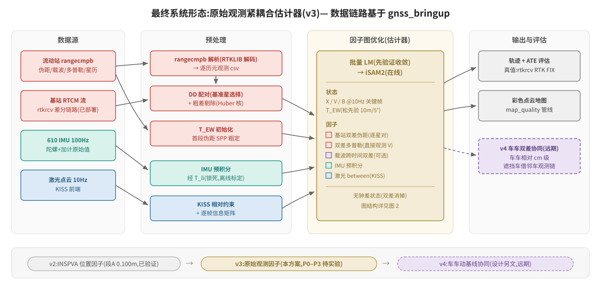
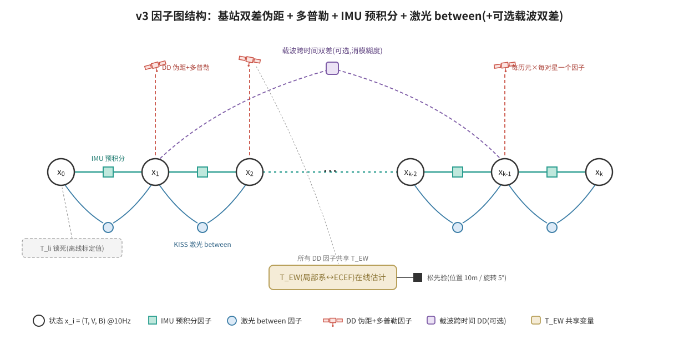
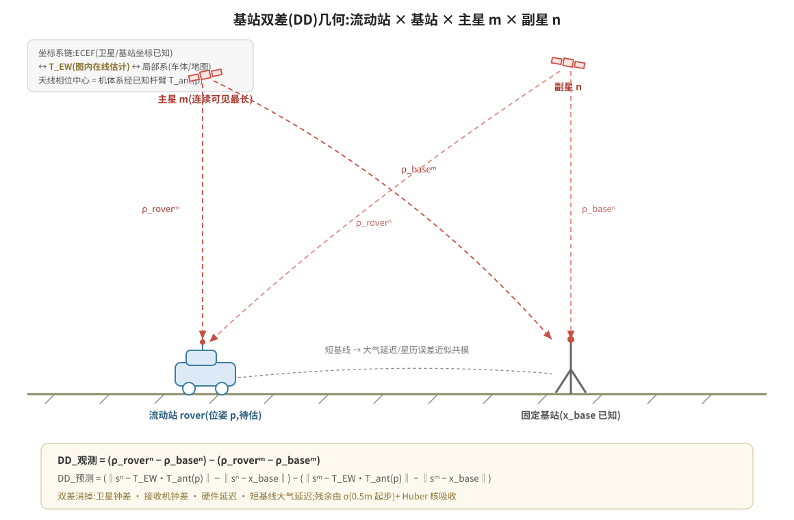
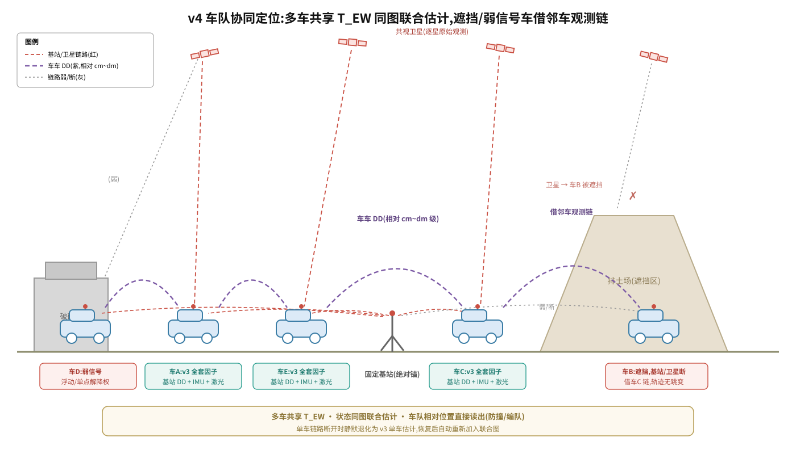

# 总体方案:GNSS 原始观测紧耦合(bringup 数据链路 → v3 因子图 → v4 车车协同)

- 日期:2026-10-31
- 状态:草案。v2 已实验、v3 已定稿、v4 仅有方向;本文档是四层路线的顶层组织,不替代各分设计,正文一律引用原文档
- 读者:需要了解"最终做成什么样、现在到哪了、接下来做什么"的项目成员
- 文档族:
  - 数据链路层(gnss_bringup):`2026-09-03-gnss-glim-modules-design.md`(主 spec,§10 轮次表)+ round2 plans(rtcm-bridge / hardening / 中煤部署)
  - v2 紧耦合原型:`2026-10-19-tight-coupling-extrinsic-calib-prototype.md`(设计)+ `../field/2026-10-19-tight-coupling-prototype-report.md`(实验报告)
  - v3 原始观测升级:`2026-10-22-raw-gnss-tight-coupling-upgrade.md`(**已定稿**,含 10-31 修订)
  - v4 车车动基线:`2026-10-31-moving-base-v4-design.md`(方向性设计,另文)
  - 阶段二定位子spec:`../../features/spec/阶段二_2.1_Spec_RTK_IMU_LO融合定位.md`(阶段二交付壳:M-A 位置级为验收基线,M-B 原始观测级对应本文 P1–P3;v4 属阶段四,不计入阶段二)
  - 数据缺口:`../field/2026-10-24-platform-data-completeness.md`(中煤驱动修改清单,**卡 P0**)

## 1. 最终效果(目标形态)

最终系统 = 车端一条**原始观测紧耦合估计链**:GNSS 锚从"610 解算后的位置"换成"逐星原始观测"——610 杆臂混淆消除、少于 4 星不丢信息、多径/NLOS 在因子级剔除。

| 指标 | 目标 | 依据 |
|---|---|---|
| 局部光滑性 | cm~dm 级;载波启用时 mm 级相对约束 | Beuchert 载波双差终点 <10cm |
| 全局绝对精度 | 亚米级(P1 验收 ATE ≤ 1m);图内 RTK(模糊度固定)后回 0.1m 级(后续可选) | GLIO2 有基站伪距+多普勒:batch 0.92m 水平 / 1.33m 3D |
| 鲁棒性 | 剔除 50% 历元轨迹无跳变;基站断链 30s 无跳变 | 逐星观测 + Huber 剔除,少于 4 星仍进图 |
| 车车相对(v4,远期) | cm~dm 级相对约束;遮挡车借邻车观测链 | 动基线双差(华测双天线定向同款机理) |
| 外参 | 平移离线标定(610 混淆已证伪);旋转+时间偏移 td 在线估计 P3 后重新评估 | v2 原型报告 + GAINS 在线时空标定 |

## 2. 现状盘点(四层)

| 层 | 内容 | 状态 | 关键结果/缺口 |
|---|---|---|---|
| 数据链路层 | gnss_bringup:rtkrcv 进程监督、rtcm_bridge、.pos 落盘、rosbag2 全量录制 | **已部署**(中煤车 192.168.7.11) | rangecmpb 原始观测流已验证可解析;RTK 差分链路在车上 |
| v2 紧耦合原型 | 610 IMU 预积分 + INSPVA 位置因子 + 激光 between(单文件 C++,GTSAM/iSAM2+批量 LM) | **已实验**(红沙泉段 A/B) | 锁外参 ATE:段 A 0.100m / 段 B 0.174m(全场最强前端);外参自由病态已证伪(610 杆臂混淆,代数证明) |
| v3 原始观测升级 | 基站双差伪距+多普勒(+可选载波双差),T_EW 进图在线估计 | **已定稿,未实验** | 红沙泉数据无原始观测,**必须换中煤数据**;P0–P3 里程碑见 v3 §2.6 |
| v4 车车动基线 | 车车原始观测双差,两车状态同图联合估计 | **方向性设计**(另文) | 启动时机:v3 P3 通过之后 |

辅助资产:gauge 调查(2026-10-19,F1 证伪回滚/F2 保留)、phase1 RTK 验证与杆臂设计(2026-10-10)、rtk_global/rtk_odometry 实车教训(CT 里程计与 RTK 约束结构性不合,GLIM 集成时必读)。

## 3. 缺口清单

| # | 缺口 | 卡哪个阶段 | 依赖方 |
|---|---|---|---|
| 1 | 中煤驱动:IMU 原始值、RTK 状态透传、卫星数/sigma、激光点时间戳、tf_static、时间同步(10-24 清单 6 项) | **P0** | 平台组 |
| 2 | rangecmpb → 逐历元伪距/载波/多普勒/星历 csv 解析器(RTKLIB 解码抽出) | P0 | 自研 |
| 3 | v3 全部实验(P0–P3) | P1–P3 | #1、#2 |
| 4 | v4 细化设计 + 双车通信链路 | 远期 | v3 P3 通过 |

## 4. 实验计划

| 实验 | 输入数据 | 内容 | 通过标准 |
|---|---|---|---|
| E-bringup 采集验证 | 中煤车开阔地(含转弯激励) | rangecmpb + 星历 + 激光 + 610 IMU 同步采集;解析器跑通 | 逐历元 csv 完整率;RTK FIX 率;各流时间对齐检查 |
| E-P0 v2 基准 | 上述新数据 | 现有 v2 位置因子版(因子用 rtkrcv FIX 输出) | ATE < 0.5m(建立基准) |
| E-P1 伪距+多普勒 | 同上 | 基站双差伪距 + 多普勒因子替换位置因子,T_EW 进图 | 收敛;ATE ≤ 1m(对标 GLIO2 batch) |
| E-P2 载波(可选) | 同上 | 加跨时间载波双差 | 局部光滑性显著优于 P1;基站断链 30s 无跳变 |
| E-P3 鲁棒性 | 同上 | 人为剔除 50% 历元/星(模拟遮挡) | 轨迹无跳变;v2 位置因子版同等剔除下失效(对照) |
| E-V4(远期) | 双车同步采集 | 联合图 + 车车 DD | 见 v4 设计 §5 |

每阶段沿用原型工作流:C++ 单文件演进(tck_calib_v3.cpp)+ 批量 LM 先验证收敛、iSAM2 后验证在线。

## 5. 分步实施路线(从 bringup 开始)

| 步 | 内容 | 产出 | 验收 | 依赖 |
|---|---|---|---|---|
| S0 | bringup 数据补全:平台组驱动修改(10-24 清单,最高优先 IMU)+ 开阔地采集 | 新数据集(原始观测+星历+激光+IMU) | E-bringup 通过 | 平台组 |
| S1 | rangecmpb 解析器;新数据上跑通 v2 基准 | 解析器 + v2 基准 ATE | E-P0:ATE < 0.5m | S0 |
| S2 | v3 P1:DD 伪距+多普勒+T_EW | tck_calib_v3.cpp | E-P1:ATE ≤ 1m | S1 |
| S3 | v3 P2(可选载波)+ P3 鲁棒性 | v3 完整因子集 | E-P2/P3 | S2 |
| S4 | v4 细化设计与原型(另文) | 车车协同原型 | E-V4 | S3 |
| S5 | GLIM 集成评估 | 决策:嫁接到 GLIM odometry/mapping 模块 or 保持独立前端 | 评审 | S3(S4 不阻塞) |

S5 必读教训(rtk_global/rtk_odometry 实车首验):CT 里程计与 RTK 绝对约束结构性不合(轨迹折叠);`smoother_lag` 必须大于 `smoother_lag_margin`;子图锚点取中点帧;先 gnss_core 级单测再实车。

## 6. 风险登记册(各文档合并去重)

| 风险 | 来源 | 等级 | 缓解 |
|---|---|---|---|
| 全局精度从 0.1m 退到亚米级(明确取舍) | v3 §3.1 | 已接受 | P1 验收按此设定;图内 RTK(模糊度固定)列 P2 后可选升级 |
| 广播星历轨道误差 ~1m 进伪距残差 | v3 §3.2 | 中 | Huber 核 + DD 共模相消;P1 暴露 |
| 中煤时间同步错位(合计可达 ~0.5s) | 10-24 #9 | **高(卡 P0)** | 驱动补时间戳;短期离线钟差标定,中期 td 进图 |
| 设备管线延迟差(串口 vs 网口,毫秒级) | v2 R1 | 中 | 残差速度相关模式监测;必要时 td 状态 |
| 中煤驱动修改依赖平台组排期 | 10-24 | **高** | 需求清单已提交;IMU 回传最高优先 |
| MEMS 零偏不稳污染姿态通道 | v2 R2 | 中 | 零偏进状态 + 后验方差检查 |
| 双车共视星集与通信覆盖 | v4 | 远期 | V4-P0 采集时实测统计 |

## 7. 与 GLIM 主线的关系

v2/v3/v4 原型独立演进(单文件 C++,不改动 GLIM 核心);验证通过后经 GLIM extension 机制(全局回调槽)嫁接,参照 rtk_global/rtk_odometry 的集成路径与教训。GLIM 侧双 gauge 问题已由 v3 的单一 T_EW 共享变量在架构上消解(2026-10-19 gauge 调查的背景)。
