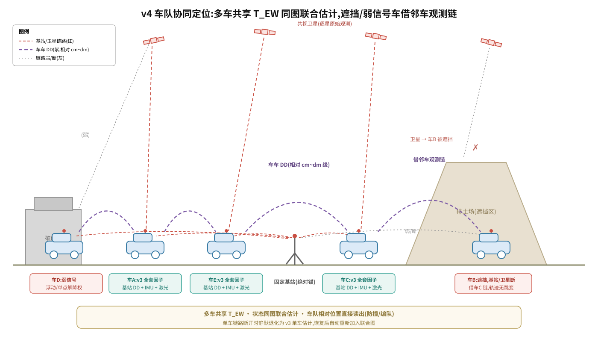

# 设计:车车动基线协同原型(v4)——方向性设计

- 日期:2026-10-31
- 状态:**方向性设计**(未经 review;细化与启动时机 = v3 P3 通过之后)
- 前置:`2026-10-22-raw-gnss-tight-coupling-upgrade.md`(v3)§3.6;顶层组织见 `2026-10-31-gnss-tight-coupling-master-plan.md`
- 本文档只定方向、因子形式、工程项与验收框架;详细设计在 v3 P3 后另立

## 1. 问题与目标

矿区多车作业:某车进入遮挡区(排土场、深坑边坡)或 RTK 掉链时,其 v3 估计器的绝对锚变弱;同时车车相对位置本身是矿区多车防撞/编队的必需量。

**目标**:在 v3 单车估计器基础上,叠加**车车原始观测双差**作为附加约束,两车状态同图联合估计:

- 遮挡/掉链车借邻车观测链维持相对约束,轨迹无跳变
- 车车相对位置 cm~dm 级



> 图为车队级目标形态（多车同图联合估计）；**原型仍先两车验证**（见 §1 非目标、§5 里程碑），车队级扩展在 V4-P3 之后。

**非目标**:不动固定基站链路(绝对锚不变,两车各自对基站做 DD);不做多车(>2)组网,先两车验证;不替代各车独立 v3——协同是附加层,车车链断开时各车静默退化为单车 v3。

## 2. 图结构(对 v3 的 diff)

| 组件 | v3 单车 | v4 双车 |
|---|---|---|
| 状态 | X/V/B @10Hz + T_EW(松先验) | 两车各自 X/V/B;**共享同一 T_EW**(统一矿区局部系原点) |
| 单车因子 | 基站 DD 伪距 + DD 多普勒(+可选载波)+ IMU + 激光 between | 不变,各车各自维护 |
| 固定基站 DD | 绝对锚 | 不变,两车分别对同一基站做 DD(双份绝对锚) |
| 车车 DD | 无 | **新增**:DD(车A, 车B, 星m, 星n) = 车间站间差 × 星间差 |

共享 T_EW 的直接收益:两车轨迹天然在同一坐标系,车车相对量直接从状态读出,无需事后对齐。

## 3. 车车双差因子

```
r_DD_AB = DD_预测 − DD_观测
DD_预测 = (‖sⁿ − T_EW·T_ant(p_A)‖ − ‖sⁿ − T_EW·T_ant(p_B)‖)
        − (‖sᵐ − T_EW·T_ant(p_A)‖ − ‖sᵐ − T_EW·T_ant(p_B)‖)
DD_观测 = (ρ_Aⁿ − ρ_Bⁿ) − (ρ_Aᵐ − ρ_Bᵐ)
```

- 消掉:卫星钟差与硬件延迟(站间差)、两车各自接收机钟差(星间差)、车间共模大气/星历误差
- **车间基线动态变化**(几十 m ~ 几百 m),大气共模假设弱于固定基线 → σ 随基线长度自适应(起步 σ = σ₀ + k·基线长,参数 V4-P2 标定)
- 星集:取两车**共视星**配对;共视星对 < 4 的历元不构因子(静默降级,不发因子)
- 载波版(可选增强):车间基线短、模糊度易固定,是 cm 级相对约束的主要来源;随 v3 载波路线一并评估

## 4. 工程项(仅三条)

1. **车车原始观测通信**:逐历元星对观测(伪距/载波/多普勒/CN0 + 星历)打包互发;带宽 ~0.5–5 KB/s/车(12 星 × ~40 B × 1–10 Hz),轻量;链路复用矿区已有车-基站网络或车车直连;**允许延迟**——滑窗内迟到补插,不要求实时对齐;数据层由 gnss_bringup 扩展(RawStream 消息已有,加车车转发节点)
2. **历元对齐**:两车各自 GPST 时标,按 GPST 历元配对;残余接收机钟差由星间差消掉(v3 §2.2 同款机理)
3. **联合估计器形态**:先**离线联合批量**(两车 bag 合并进同一图,验证因子正确性)→ 后**在线**(一车为主节点,邻车观测经链路进主节点的图;形态选型留到细化设计)

现成参照:华测双天线定向本身就是动基线 RTK(主辅天线互为基准),固件链路层已通;车车版只是跨设备扩展。

## 5. 里程碑与验收

| 阶段 | 内容 | 验收 |
|---|---|---|
| V4-P0 数据 | 双车同步采集:同时段 rangecmpb + 星历 + 激光 + 610 IMU,含"一车开阔一车遮挡"互补段 | 共视星对统计(≥4 对的历元占比);历元配对完整率 |
| V4-P1 单车基线 | 两车各自 v3 跑通 | 各自 ATE ≤ 1m(复现 v3 P1) |
| V4-P2 联合图 | 离线联合批量 + 车车 DD 因子 | 车车相对轨迹 cm~dm 级(对双天线定向/全站仪参考);一车人为剔除 50% 历元,相对约束维持、轨迹无跳变 |
| V4-P3 在线化(可选) | 主节点在线联合估计 | 一车 RTK 掉链 30s,借邻车链轨迹无跳变 |

## 6. 风险与开放问题

1. **车间基线动态** → 大气共模假设弱于固定基线;σ 自适应参数待 V4-P2 实测标定
2. **共视星集悖论**:遮挡车往往共视星也少(同一片遮挡)——车车 DD 在"互补遮挡"场景价值最大,"同时遮挡"场景退化为各车独立(这也是不放弃单车 v3 完整性的原因)
3. **参考真值**:双天线定向(基线 ~1m,航向 ~0.1°)在车间距 20m 时横向参考精度 ~3.5cm,够做 V4-P2 参考;更大间距需全站仪或第三台 RTK 移动站
4. **在线化通信时延/丢包**:滑窗补插容忍秒级;分钟级断链退化单车 v3,不发过期因子

## 7. Out of Scope

- 多车(>2)组网与因子图分配
- 跨车回环与地图级协同(各车地图合并)
- 车车载波模糊度固定的工程化(随 v3 载波路线一并评估)
